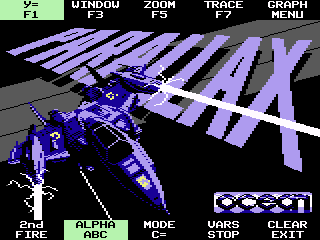
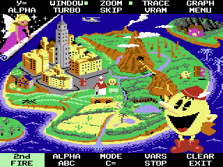

# Emudore CE

Emudore CE is a Commodore 64 emulator for the TI-84 Plus CE, built around a portable C core with CE-specific I/O, ROM packaging, and a native JIT path for the eZ80 target. The project aims to preserve the behavior of classic C64 software while staying within TI-OS memory and runtime constraints.

The emulator currently includes:

- A complete 6510 CPU core and C64 memory map
- VIC/keyboard/peripheral integration for calculator input and display
- Browser-driven disk and ROM management for packaged C64 media
- Native eZ80 JIT dispatch and re-entry checks for hot paths
- Automatic AppVar generation for ROMs, cartridges, and disk images
- Release and profiling builds that are validated in CEmu and host-side regression tests

Learn more about the original system: [C64 Wiki](https://www.c64-wiki.com/)

## Screenshots

| <div align="center"><br>Demo 1</div> | <div align="center"><br>Demo 2</div> | <div align="center"><br>Demo 3</div> |
| --- | --- | --- |
| <div align="center"><br><strong>Parallax</strong></div> | <div align="center"><br><strong>Pac-Man</strong></div> |  |

## Current status

The current tree is not a generic C64 port in the abstract; it is the active CE build used for emulator validation, compatibility work, and performance tuning. The JIT, browser, disk packaging, and startup-memory paths are all part of the current design.

The most relevant project docs are:

- [docs/performance.md](docs/performance.md) — current rendering and validation workflow
- [docs/startup-memory.md](docs/startup-memory.md) — TI-OS memory limits and linker constraints
- [docs/jit-performance-handoff.md](docs/jit-performance-handoff.md) — JIT profiling and re-entry notes
- [docs/jit-game-crash-investigation.md](docs/jit-game-crash-investigation.md) — active 10K and input-driven Parallax target-crash investigation
- [docs/emudore-ce.md](docs/emudore-ce.md) — development notes and verified behavior, including hot-path fixes and CE-specific caveats

## Features

- 6510 CPU emulation with ROM/JIT gating and validated native execution paths
- C64 ROM, cartridge, and disk packaging through calculator AppVars
- Startup browser with launcher lists, hidden entries, and disk preference persistence
- TI-84+ CE input mapping, graphics integration, and menu settings
- Performance profiles for release, CPU-hot diagnostics, and frame-skip control
- Host and CEmu regression tests covering browser, I/O, VIC, drive, and JIT behavior


## Controls and settings

Controls are not a single fixed profile for every C64 title. Many titles depend on keyboard input, joystick conventions, or game-specific mappings. The emulator implements the calculator-side conventions used by the project’s graphics and browser UI, while leaving the guest-side behavior to the game itself.

### Browser

When a disk package is installed, the browser shows a scrolling file list, a selected-file information panel, and launcher/view preferences. It uses the existing visible framebuffer and does not draw into C64 RAM.

| Key | Action |
| --- | --- |
| `UP` / `DOWN` | Move selection |
| `LEFT` / `RIGHT` | Move one page |
| `Y=` | Toggle Launchers / All Files |
| `ALPHA` | Mark or unmark the selected file as a launcher |
| `TRACE` | Return to the previous browser state or exit the browser flow |
| `ENTER` | Open the selected program, or BASIC without a disk |
| `CLEAR` | Save browser preferences and quit |

The browser persists launcher assignments and the selected view in a separate AppVar, while keeping support files available to the C64 loader even when they are not currently shown in the browser UI. See [tests/browser/README.md](tests/browser/README.md) for browser regression coverage.

### Calculator keys and menu settings

Press `GRAPH` during emulation to pause and open the settings menu. Press `GRAPH` again or choose `Resume` with `ENTER` to continue. The emulator exposes the standard TI-84+ CE key mapping plus the project’s C64-style function-key setup.

| Key | Default C64 action | Alternate / modifier action |
| --- | --- | --- |
| `Y=` | `F1` | `2nd + Y=` toggles alpha lock |
| `WINDOW` | `F3` | `2nd + WINDOW` toggles Turbo CPU/RAM between `1x` and `200x` |
| `ZOOM` | `F5` | `2nd + ZOOM` toggles frame skipping |
| `TRACE` | `F7` | `2nd + TRACE` toggles VRAM view |
| `GRAPH` | Pause / Settings | Unchanged |
| `MODE` | Commodore `C=` | Unchanged |
| `VARS` | `RUN/STOP` | Unchanged |
| `ARROWS` | Joystick port 2 and cursor keys | Unchanged |
| `2nd` | Joystick fire and symbol layer | `2nd + key` enables the hotkeys above |
| `ALPHA` | Printed letter layer on digit keys | Locks the letter layer while held or toggled by `2nd + Y=` |
| `CLEAR` | Quit emulator | Unchanged |

The menu and indicator state reflects the active toggles in the running session:

| Setting | Current behavior |
| --- | --- |
| Turbo CPU/RAM | `1x`, `50x`, `100x`, `200x`, or `Adaptive` |
| Frame skip | `Adaptive` or `Off` |
| Key indicators | Enabled by default in the MENU overlay |
| Function keys | Even/odd bank selection is handled in the active key indicator state |

Use `1x` for normal compatibility testing. Higher multipliers change CPU/device timing ratios and can disturb timing-sensitive games. They do not add calculator clock speed or guarantee improved gameplay.

## Build

1. Install the CE toolchain and required C libraries.
2. Ensure Python 3 is available.
3. Open a CEdev shell in the project directory.
4. Build the emulator with:

```bash
make
```

This produces the release image in `bin/EMUDORE.8xp` and prepares any AppVars needed for calculator execution.

The build is intentionally tuned for the CE toolchain and current runtime constraints. The project currently keeps `-fno-omit-frame-pointer` and uses `-Oz` in the hot compile paths and package-management code. A memory-limit issue can still arise if the target image or library usage exceeds the available program area, so see [docs/startup-memory.md](docs/startup-memory.md) for the linker and startup constraints.

## Asset packaging

The Makefile contains the current packaging targets for ROM, cartridge, and disk media. The active workflows are:

```bash
make roms
make cart CART="path/to/cart.bin"
make files
make disk DISK="tests/FINALBLW.D64"
```

The generated AppVars are used by the emulator’s startup loader and browser. Disk packaging supports D64/T64 conversion into calculator-friendly AppVars for C64 file access and fastloader-style behavior within the current drive logic.

## Performance and validation

The current emulator includes a native eZ80 JIT path and a validation harness that checks cache behavior, re-entry paths, native CPU correctness, and Parallax-style startup scenarios. The project expects validated throughput to be checked in CEmu with the intended throttle and playback settings, not by unbounded host speed results.

Use the project verification tasks when working on a change:

```bash
make -C tests/jit target-extensions-check
make -C tests/jit target-reentry-check
make -C tests/jit check startup-check cpu-check
```

The detailed performance and compatibility notes live in [docs/performance.md](docs/performance.md) and [docs/jit-performance-handoff.md](docs/jit-performance-handoff.md).

## Profiling and diagnostics

The project supports profile-oriented builds for diagnosing hot code and render cost. The current pattern is:

```bash
make
make PROFILE=1
```

The release image is `bin/EMUDORE.8xp`; the profiling build is in `bin/profile`. The profile binary reports sampled emulated/render FPS, frame timings, and the relevant hot-path details after emulation exits. The memory-limited startup path and compressed-image constraints are described in [docs/startup-memory.md](docs/startup-memory.md).

## Normal and Calculator-Oriented Conversion

The existing `roms`, `cart`, `files`, and `disk` commands retain their package
formats and write to `bin/rom`. D64 conversion also emits optional browser file
information. Separate `roms-optimized`, `cart-optimized`,
`files-optimized`, and `disk-optimized` targets write to `bin/optimized`:

```sh
make disk DISK="tests/FINALBLW.D64"
make disk-optimized DISK="tests/FINALBLW.D64"
```

`disk-optimized` now changes recognized MR.CROSS V2.0 decoder code: it removes
two redundant CPU-bank writes per decoded byte while preserving decoded data
and the screen counter. The selected FINAL BLOW disk saves 484,260 emulated
bootstrap cycles and 96,852 bank writes in the independent CPU test. This is
startup decompression work, not a measured improvement in fight FPS. The
recognizer checks packer code and stream bounds, not the game filename.

The disk target fails without writing new packages if no code transformation
matches. Direct converter use can still make unchanged packages, explicitly
reported as `NO CODE OPTIMIZATION APPLIED`. Normal conversion and source disks
remain unchanged. Reports include per-file hashes, transformations, guest-cycle
savings, and archive savings as separate fields.

`roms-optimized` only changes firmware packaging; it does not optimize a disk
game. Identical PRGs can also share stored bytes. Explicit SHA-256 profiles
remain available for other reviewed patches or prepared replacements.

See [converter optimization](docs/converter-optimization.md) for dry runs,
profile requirements, compatibility limits, and examples. This is not an
automatic arbitrary-game optimizer or a measured gameplay speedup.

## Example workflow

A common flow is:

```bash
make roms
make files
make disk DISK="tests/FINALBLW.D64"
make
```

This prepares the ROMs, software files, and disk assets before building the emulator itself.

## Credits

- Developed by: Alvajoy "Alvajoy123" Asante
- Platform: TI-84 Plus CE
- Original hardware: Commodore 64 and its software ecosystem
- Project status: emulator development focused on C64 compatibility and portable calculator execution
- Reference: [emudore](https://github.com/marioballano/emudore) by Mario Ballano, a C64 emulator whose source assisted this project's early development

---
Copyright 2026 Alvajoy "Alvajoy123" Asante. All rights reserved.